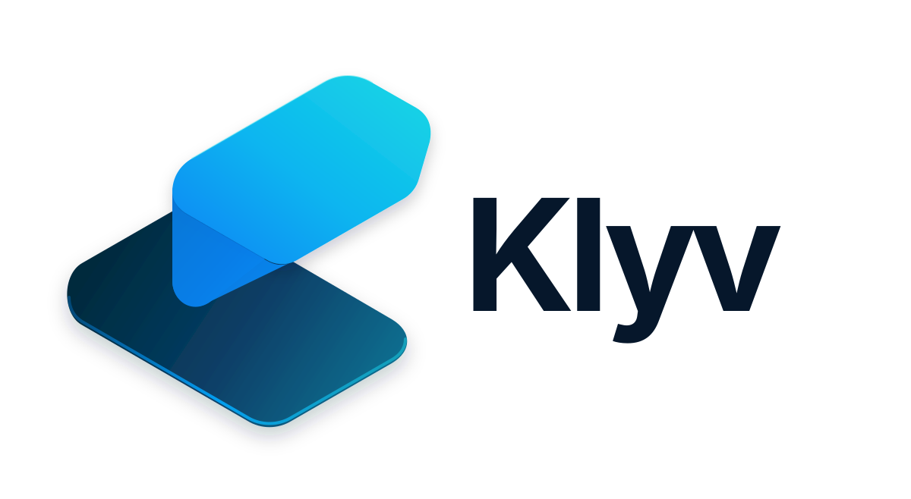

# Klyv — Landing Page Oficial & Portal Web Institucional

<p align="center">
  
</p>

<p align="center">
  <strong>Website institucional e landing page oficial de conversão do Klyv CRM.</strong>
</p>

---

## 🚀 Sobre o Projeto

O **front-web** é o portal institucional público do **Klyv CRM**, projetado para apresentar a proposta de valor da plataforma, suas capacidades analíticas e o poder do copiloto de IA comercial (Lia). Desenvolvido com **Next.js 16 (App Router)** e **React 19**, o portal entrega carregamento ultra-rápido, animações refinadas, demonstrações interativas de produto e conformidade técnica de SEO.

---

## ✨ Recursos & Seções em Destaque

- 🌟 **Hero Section de Alto Impacto**:
  - Apresentação da proposta de valor com tipografia *Plus Jakarta Sans*.
  - Call-to-actions claros direcionados para teste gratuito e demonstração.
- 🤖 **Lia Showcase (Simulador Interativo)**:
  - Demonstração prática das capacidades de inteligência comercial da assistente Lia.
  - Simulações de perguntas executivas sobre pipeline, potencial de faturamento e taxas de conversão.
- 📊 **Interactive Dashboard Preview**:
  - Prévia ao vivo dos gráficos de Meta por Mês, funil de vendas e distribuição de receita do CRM diretamente na página.
- 💳 **Planos & Tabela de Preços**:
  - Comparativo transparente entre os planos *Basic* e *Pro*.
  - Alternador de ciclo de faturamento (Mensal / Anual com desconto promocional).
- ⚖️ **Central Jurídica & Termos de Uso**:
  - Páginas dedicadas para Termos de Serviço e Privacidade em conformidade com as diretrizes vigentes.
- 🔍 **SEO & Otimização Técnica**:
  - Geração nativa de `sitemap.xml` e `robots.txt`.
  - OpenGraph tags e metadados estruturados para indexação em buscadores.

---

## 🛠️ Stack Tecnológica

- **Framework**: [Next.js 16 (App Router)](https://nextjs.org/)
- **Biblioteca Base**: [React 19](https://react.dev/)
- **Linguagem**: [TypeScript 5](https://www.typescriptlang.org/)
- **Estilização**: [Tailwind CSS v4](https://tailwindcss.com/)
- **Gráficos**: [Recharts](https://recharts.org/)
- **Ícones**: [Lucide React](https://lucide.dev/)
- **Tipografia**: `@fontsource-variable/plus-jakarta-sans`

---

## 📦 Como Executar Localmente

### Pré-requisitos
- Node.js `20.x` ou `22.x`
- Gerenciador `npm`

### 1. Instalação
```bash
git clone https://github.com/diegobayerl/front-web-klyv.git
cd front-web-klyv
npm install
```

### 2. Rodar em Desenvolvimento
```bash
npm run dev
```
Acesse `http://localhost:3000` no seu navegador.

### 3. Build e Validação de Produção
```bash
npm run build
npm start
```

---

## 🌐 Deploy em Produção (Vercel)

O projeto está otimizado para deploy instantâneo na **Vercel**:
1. Conecte o repositório `front-web-klyv` no dashboard da Vercel.
2. O framework preset será detectado automaticamente como **Next.js**.
3. O build e as rotas estáticas/server-rendered serão provisionados na Edge Network global.
